# Quest 3–Based Bimanual Teleoperation of DOBOT E6 Robots

**Yang Taige · The University of Hong Kong · ME capstone project**

An inspectable VR-to-robot control stack, from first motion to a calibrated bimanual workflow.

[SDK source](https://github.com/EDDY-YANG/quest3-dual-e6-teleoperation/tree/main/sdk) · [Grippers](docs/GRIPPER.md) · [Changelog](CHANGELOG.md) · [Installation](docs/SDK_INSTALL.md) · [Terminal examples 01–06](docs/SDK_EXAMPLES.md) · [View the project website](https://eddy-yang.github.io/quest3-dual-e6-teleoperation/) · [▶ Watch videos](https://eddy-yang.github.io/quest3-dual-e6-teleoperation/#nov24-virtual-trials) · [Repository guide](docs/REPOSITORY.md)

This repository contains the project showcase, documentation and historical-log analysis. The Release ZIP includes all thirteen editable SDK packages and the Windows native solver. Extract it and double-click **OPEN_IN_VSCODE.cmd** on a Windows x64 PC with Python 3.10 and desktop VS Code.

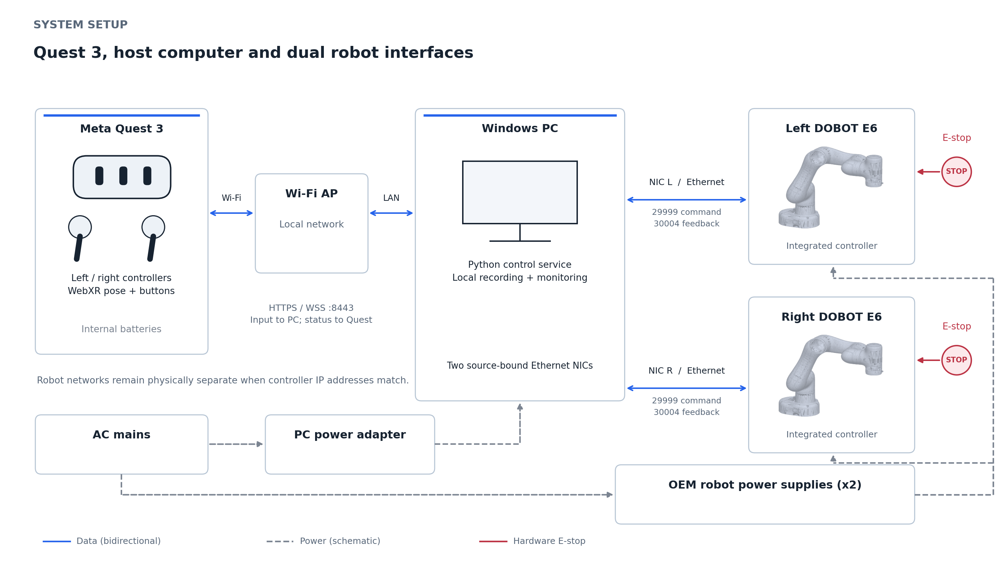

*Data links, power relationships and independent hardware E-stops. E6 appearance uses the official visual meshes; the illustrated pose is not a live measurement.*

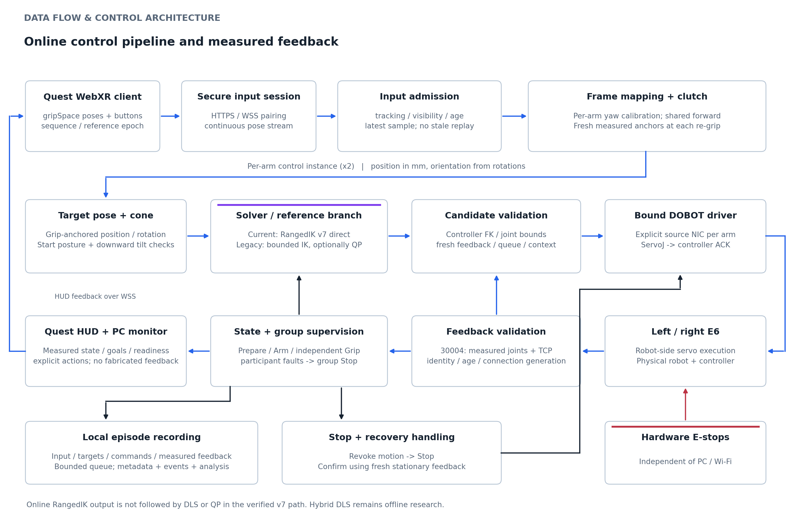

*Current online path: RangedIK v7 direct. No deployed RangedIK-to-DLS cascade is established by these logs.*

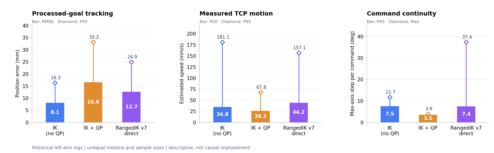

| Metric | 🔵 IK (no QP) | 🟠 IK + QP | 🟣 RangedIK v7 direct |
|---|---:|---:|---:|
| Log dates | 2026-11-04 | 2026-11-04 | 2026-11-17 |
| Arm records / records with tracking | 7 / 4 | 12 / 11 | 17 / 14 |
| Eligible closed-Grip duration (s) | 12.83 | 67.61 | 276.74 |
| Processed-goal position RMSE / P95 (mm) | 8.09 / 16.33 | 16.58 / 33.15 | 12.67 / 24.94 |
| Accepted-reference position RMSE / P95 (mm) | 8.07 / 16.33 | 4.58 / 8.93 | 10.95 / 21.65 |
| Processed-goal orientation P95 (deg) | 6.08 | 11.38 | 3.11 |
| Accepted-reference orientation P95 (deg) | 6.08 | 2.69 | 2.86 |
| Measured TCP speed P50 / P95 (mm/s) | 34.82 / 181.13 | 26.19 / 67.82 | 44.19 / 157.08 |
| Joint-command step P95 / max (deg) | 7.54 / 11.75 | 3.53 / 3.93 | 7.44 / 37.36 |
| Non-normal STOP events (all Arm records) | 7 | 12 | 16 |
| Recorded queue drops | 0 | 0 | 0 |

In these selected left-arm records, v7 has lower processed-goal position RMSE and higher median TCP speed than IK + QP. QP nevertheless has smaller accepted-reference error and substantially smaller command steps; the v7 maximum step remains visible in the figure. These are observational trade-offs, not proof of overall superiority or of a deployed hybrid DLS advantage.

Processed goals, accepted references and raw hand intent are distinct. Command step size measures output continuity, not physical vibration. [Definitions and exclusions](analysis/methods.md) · [Summary CSV](analysis/results_v4/stage_metrics.csv) · [Per-record CSV](analysis/results_v4/per_record_metrics.csv).

**24 November 2026 · Virtual task trials** — Two new recordings, appended to the seven existing videos. [Watch the virtual trials](https://eddy-yang.github.io/quest3-dual-e6-teleoperation/#nov24-virtual-trials).

<a href="https://eddy-yang.github.io/quest3-dual-e6-teleoperation/#dual-arm-spoon-bowl">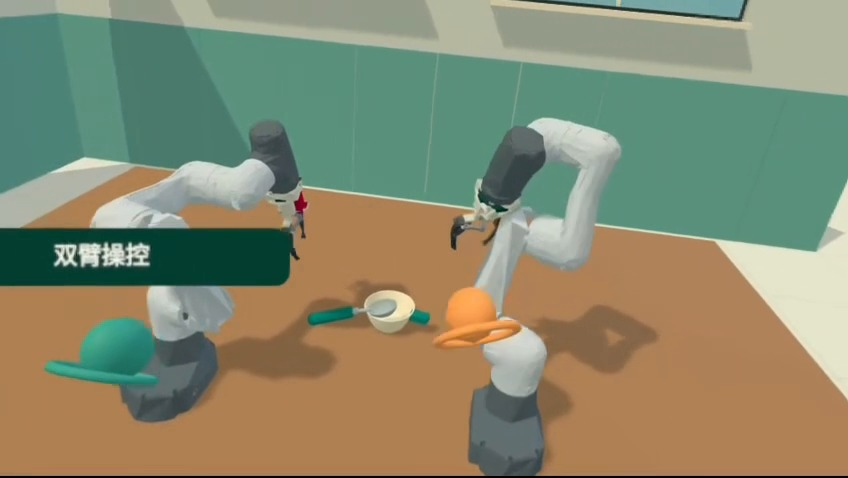</a> <a href="https://eddy-yang.github.io/quest3-dual-e6-teleoperation/#single-arm-topping-attempt">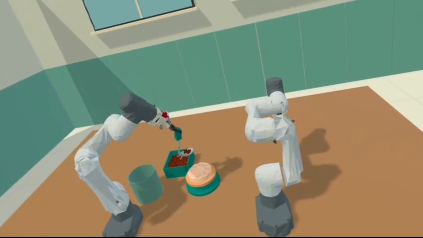</a>

- **Dual-arm dexterity: spoon and bowl** — 61.4 s. Exploratory manipulation using both virtual E6 arms.
- **Single-arm topping simulation — unsuccessful attempt** — 77.5 s. A virtual arm attempts to scoop dry powder and deposit it onto the central cake. The intended task was not completed successfully.

Both clips are full-length virtual-environment recordings with original audio. They do not establish physical-robot performance and are not time-aligned with the hardware logs. Videos and posters require written permission for reuse. [Video terms](assets/videos/VIDEO_RIGHTS.md).

**Single-arm manipulation** — Right-hand control of the physical E6 and gripper. [Watch both demonstrations](https://eddy-yang.github.io/quest3-dual-e6-teleoperation/#gripper-demonstrations).

<a href="https://eddy-yang.github.io/quest3-dual-e6-teleoperation/#gripper-demonstrations">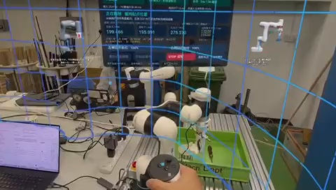</a> <a href="https://eddy-yang.github.io/quest3-dual-e6-teleoperation/#gripper-demonstrations">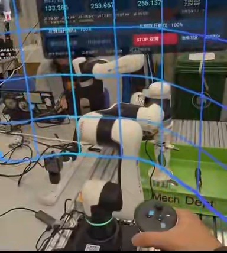</a>

Everyday objects — 65.3 s, audio removed. M6 nut pickup — 12.1 s, source audio retained. [Gripper code and setup changes](docs/GRIPPER_UPDATE.md). Videos and posters require written permission for reuse. [Video terms](assets/videos/VIDEO_RIGHTS.md).

**Development footage** — dates supplied by the author; exact clip-to-log alignment has not been established.

**© 2026 Yang Taige. All rights reserved for the videos and their preview images.** Viewing on the project website only. Downloading, recording, screenshots, reposting, or other reuse requires prior written permission, subject to applicable law and existing permissions. [Video terms](assets/videos/VIDEO_RIGHTS.md).

<a href="https://eddy-yang.github.io/quest3-dual-e6-teleoperation/#development">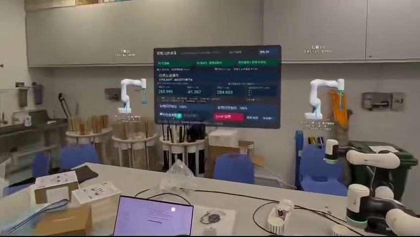</a> <a href="https://eddy-yang.github.io/quest3-dual-e6-teleoperation/#development">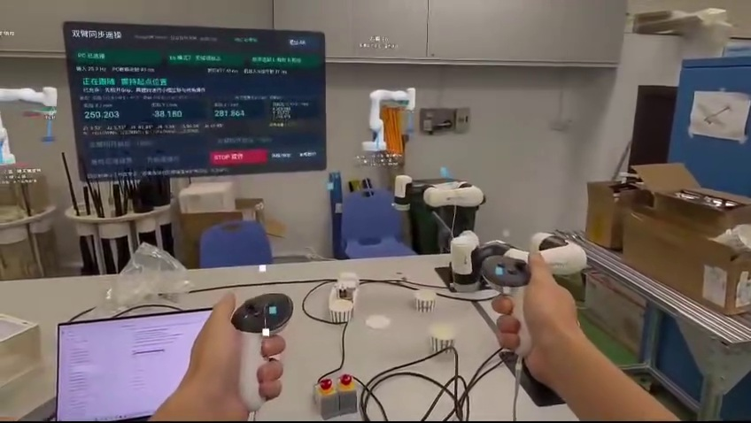</a> 

<a href="https://eddy-yang.github.io/quest3-dual-e6-teleoperation/#development">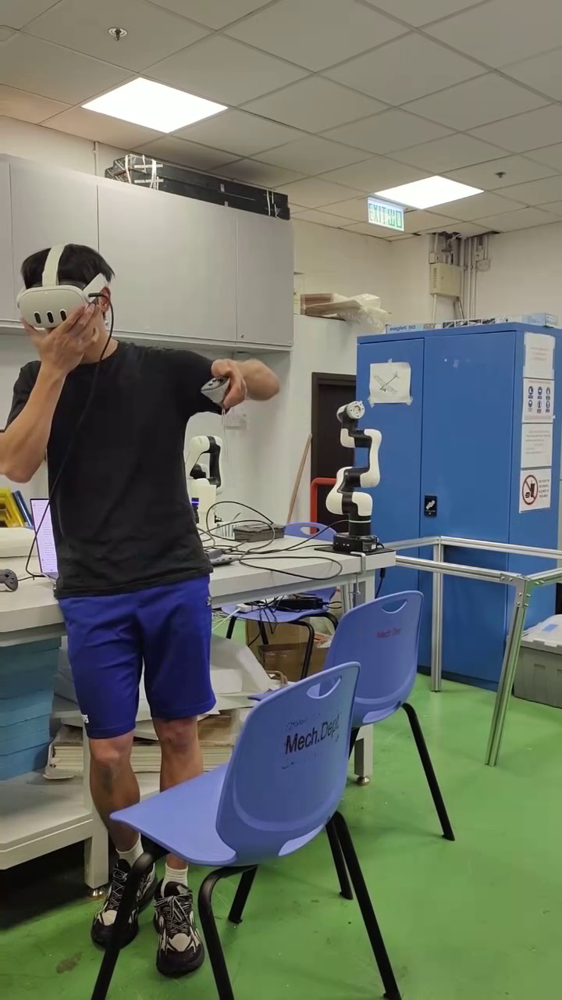</a> <a href="https://eddy-yang.github.io/quest3-dual-e6-teleoperation/#development">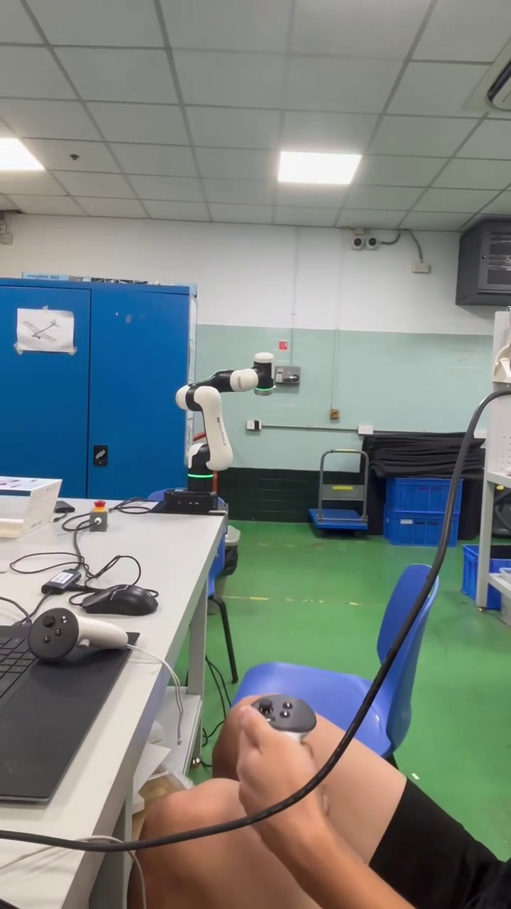</a> <a href="https://eddy-yang.github.io/quest3-dual-e6-teleoperation/#development">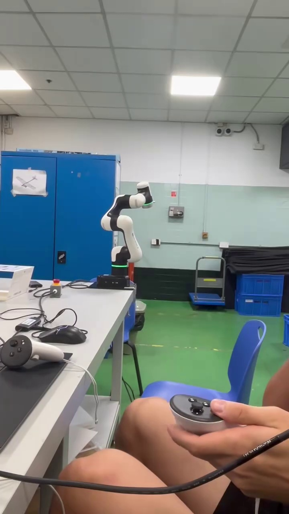</a> 

The first recordings established robot motion and exposed stalls and control faults. Later work investigated reference smoothing and tracking limitations. The latest VR interface integrates frame calibration, per-arm start return, reconnection, explicit recovery and recording.

[Operation manual](docs/OPERATIONS.md) · [Code walkthrough](docs/CODE_TOUR.md) · [Media provenance](docs/media_manifest.json) · [Publication boundaries](docs/GITHUB_PREPARATION.md)

**PC & VR interface** — [Explore selected functional panels](https://eddy-yang.github.io/quest3-dual-e6-teleoperation/#interfaces). The v0.2.0 workspace shows both mounted grippers around the central controls in an authentic SDK mirror export. The 17 Nov hardware feedback view is retained separately. Expand the function panels for current source-rendered details; no headset-video screenshots are used.

The headset-first workflow supports a single operator: recheck, calibrate, Grip control, Stop and guarded return-to-start. Recovery clears only eligible collision protection; other alarms and hardware stops still require inspection. [Workflow and recovery](docs/HEADSET_WORKFLOW.md).

**Teleoperation frame calibration** — Record each arm’s base +X direction; fixed WebXR up supplies the vertical constraint, and cross products complete a right-handed frame. Fresh Grip anchors map relative hand motion to TCP targets. [Full procedure and equations](docs/CALIBRATION.md).

**Acknowledgments** — We thank the RangedIK authors and the researchers behind damped least-squares IK (DLS). [IEEE references](docs/REFERENCES.md) · [BibTeX](docs/references.bib).
