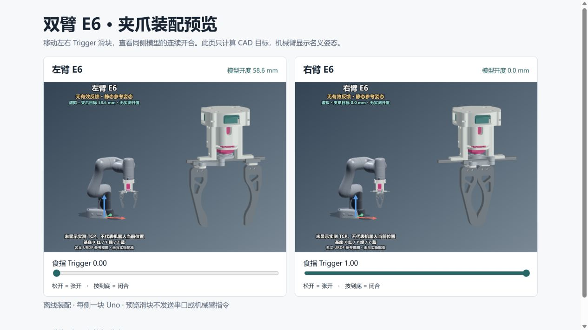

# Trigger-controlled parallel grippers

The left controller drives the left gripper and the right controller drives the right gripper. In the preview above the left Trigger is released and the right Trigger is fully pressed. The CAD reference gap is 58.6 mm on the left and 0.0 mm on the right. Half travel gives 29.3 mm. The physical range of each assembled gripper must be measured.

The gripper is attached to the E6 Link6 flange using the four-hole pattern in the supplied STEP and the manufacturer's E6 model. A crank and two constant-length connecting rods drive two sliding fingers. The opening target comes from the analog Trigger; UI interaction captures that trigger until released. Grip remains the arm-following control.

**Try it locally.** Extract the [Windows SDK](https://github.com/EDDY-YANG/quest3-dual-e6-teleoperation/releases/latest/download/quest-e6-sdk-windows-x64.zip), run `OPEN_IN_VSCODE.cmd`, then start the SDK service from its root:

~~~powershell
powershell.exe -NoProfile -ExecutionPolicy Bypass -File .\sdk.ps1 start -NoBrowser
~~~

With the service running, open [the local asset preview](http://127.0.0.1:8765/asset-preview). Both sliders operate without hardware. The [PC monitor](http://127.0.0.1:8765/monitor) and [headset mirror](http://127.0.0.1:8765/hud-preview) use the same arm and gripper renderer.

The physical integration provides independent USB serial channels to two Arduino Uno boards. Each board drives one XINHUI 20KG positional servo. The CAD's servo-body envelope is labelled MG996R. Board identity, actual servo endpoints, mechanical clearance and real tool parameters must be checked on the assembled hardware. No serial port is enabled by default. Future PCB transport can implement the existing driver interface.

- [Hardware checklist and bench commands](BENCH_TEST.md)
- [Gripper source and calibration guide](https://github.com/EDDY-YANG/quest3-dual-e6-teleoperation/blob/main/sdk/GRIPPER.md)
- [Shared asset interface](https://github.com/EDDY-YANG/quest3-dual-e6-teleoperation/blob/main/sdk/ASSETS.md)
- [Public changelog](../CHANGELOG.md)
