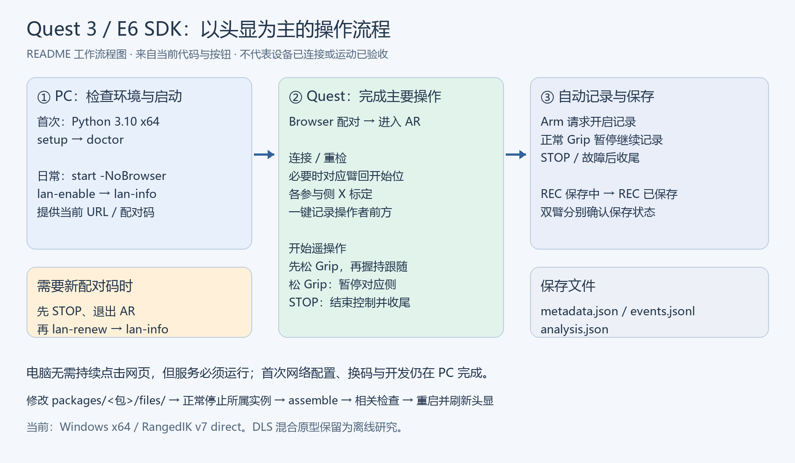

> Windows x64 v0.1.0 · [下载 SDK](https://github.com/EDDY-YANG/quest3-dual-e6-teleoperation/releases/latest/download/quest-e6-sdk-windows-x64.zip) · [完整环境安装命令](SDK_INSTALL.md) · [01–06 终端示例](SDK_EXAMPLES.md)。下文源码路径对应发行 ZIP。

# Quest 3 / DOBOT E6 Teleoperation SDK

面向代码阅读、修改和实验复现的 Quest 3 单臂／双臂遥操作 SDK。前端、连接、通信、标定、逆运动学、执行控制和记录代码均按链路分包，使用同一个启动入口。

**日常操作以 Quest 3 为主：电脑启动服务并提供地址／配对码 → 头显连接／重检 → 回位与标定 → 开始遥操作 → STOP → 自动保存数据。** 电脑端不需要持续点击网页，也不需要逐个运行算法文件；电脑服务必须一直运行。首次网卡／证书配置、更新配对码、查看数据和开发仍在电脑完成。

当前运行平台：**Windows x64，参考 Python 3.10.11**。VS Code 是可选编辑器，不包含运行此 SDK 所需的 Python 环境。当前原生库是 Windows DLL；macOS 尚未完成完整适配与验证。

当前在线算法为 **RangedIK v7 direct**。传统 DLS、旧 QP 和 RangedIK＋受约束 DLS 离线研究均保留，但不因源码存在而自动参与当前在线控制。此项目不是 Meta、DOBOT 或 Galbot 官方 SDK。



## 导航

- [1. 第一次运行：检查环境与启动](#environment)
- [2. 检查 E6 和 Quest 连接](#connection)
- [3. 查看／刷新给 Quest 的配对码](#pair-code)
- [4. 在 Quest 中回位、标定和遥操作](#quest-operation)
- [5. 数据怎样开始记录、保存和读取](#recording)
- [6. 每次使用的简短流程](#daily-use)
- [7. 理解代码链路与修改参数](#development)
- [8. 常见问题与验证范围](#troubleshooting)
- [9. GitHub 发布边界](#github)

## 先分清三种状态

| 状态 | 能证明什么 | 不能证明什么 |
|---|---|---|
| `doctor` 通过 | 当前解释器、依赖可发现、必要文件、部分哈希／配置结构符合检查 | 不证明设备已经连接 |
| E6 查询／反馈及 Quest 输入有效 | 相应链路正在提供可识别数据 | 不证明运动已经允许或跟随性能合格 |
| 显式开始后 Grip 跟随 | 系统允许满足条件的目标进入控制链 | 实体跟踪质量、停止距离和避碰仍需单独验收 |

**没有 E6 和 Quest 也可以完成环境检查、阅读代码、运行隔离软件检查。** 未连接设备时应如实显示未连接；本 SDK 不用虚构输入替代真机追踪。

<a id="environment"></a>
## 1. 第一次运行：检查环境与启动

### 1.1 在哪个目录运行？

解压后打开 SDK 根目录。该目录同时包含 `sdk.ps1`、`START_SDK.cmd`、`packages/` 和 `tools/`。以下电脑端命令都从这里执行；不要在单个 `packages/.../files/` 目录直接启动后端。

```text
Quest_E6_SDK/
├─ README.md                  本操作手册
├─ sdk.ps1                    统一入口
├─ START_SDK.cmd              首次 setup 后启动服务的快捷入口
├─ packages/                  可编辑源码；每包有说明及文件清单
├─ tools/assemble_sdk.py      将各包组装为运行目录
└─ app/                       自动生成的运行目录
```

`packages/` 是编辑源，`app/` 是组装结果。第一次 `setup` 会在需要时自动组装。不要把这两个位置维护成两套不同的实现。

### 1.2 先检查 Python

在 SDK 根目录打开 PowerShell：

```powershell
python --version
python -c "import sys, struct; print(sys.executable); print('bits =', struct.calcsize('P') * 8)"
```

参考环境是 Python **3.10.11、64 位**。`python` 不存在时，先安装 Python 3.10 x64 并确认当前终端能找到它。安装 VS Code 或其 Python 扩展不能替代这一步。不要把不同 Python 版本的依赖安装结果视为本项目已验证环境。

### 1.3 安装本项目依赖

```powershell
powershell -NoProfile -ExecutionPolicy Bypass -File .\sdk.ps1 setup
```

这一步组装文件、创建 `app/.venv/`，并按固定依赖清单安装 Python 包，包括 Wi-Fi HTTPS 所需的 `cryptography`。首次安装需要能访问依赖下载源。它不安装机器人驱动、不修改网卡地址、不自动开放防火墙，也不连接或使能机械臂。

普通运行无需安装 Rust、Visual Studio C++ Build Tools 或 Node.js：RangedIK DLL 和前端模块已经随包提供。只有修改 Rust 并重编原生库时才需要构建工具。

以下示例统一使用 `powershell ... -File` 写法，只为该进程指定脚本执行策略，不修改系统持久执行策略。

### 1.4 检查环境

```powershell
powershell -NoProfile -ExecutionPolicy Bypass -File .\sdk.ps1 doctor
```

| 输出 | 怎么处理 |
|---|---|
| `PASS` | 对应检查通过；继续下一项 |
| `FAIL` | 先修复该项，不继续进入运动流程 |
| `WARN usb_adb` | 使用本文 Wi-Fi 路线时可暂不安装 ADB |
| `WARN lan_certificate` | 新环境尚未生成证书；按第 2 节配置 |
| `WARN dependency:cryptography` | 虽被离线检查标为可选，本文 Wi-Fi 配证书必须安装；重新检查 setup 结果 |

`doctor` 不访问机器人，证书检查也仅确认文件存在，不证明其 IP 与当前网卡相符或尚未过期。

首次在另一台电脑运行时，再做第 7.4 节的无设备检查，实际加载 DLL 并执行名义求解。`doctor` 的 PASS 不包括这一项原生库运行验证。

### 1.5 启动服务：日常的第一个运行入口

```powershell
powershell -NoProfile -ExecutionPolicy Bypass -File .\sdk.ps1 start -NoBrowser
```

启动链为 `sdk.ps1 → app/sdk.ps1 → start-rangedik.ps1 → server.py`，默认读取 `profiles/rangedik_world_anchor.json`。`-NoBrowser` 避免自动打开电脑页面，之后主要用头显操作。

确认电脑本地 API 有响应：

```powershell
$state = Invoke-RestMethod 'http://127.0.0.1:8765/api/status'
$state | Select-Object project_id, mode
$state.teleop | Select-Object state, armed, participants
```

预期项目 ID 为 `quest3-dual-e6-readonly-20261029`（历史兼容名称）；新启动时没有自动参与臂、`armed` 为 false。**启动服务不等于连接机器人或允许运动。**

如提示 8765 已占用，先确认是否已有本 SDK／原工程的服务。两个副本不能同时占用该端口；不要直接结束未知进程。

<a id="connection"></a>
## 2. 检查 E6 和 Quest 连接

### 2.1 连接拓扑与配置位置

```text
Quest 3 Browser ── Wi-Fi / HTTPS + WSS :8443 ── Windows PC
                                                    ├─ 独立以太网链路 ── 左 E6
                                                    └─ 独立以太网链路 ── 右 E6
PC 本地管理／诊断：127.0.0.1:8765
E6 命令端口：29999    E6 实测反馈：30004
```

首次 setup 后，在 SDK 根目录创建仅供本机使用的配置：

```powershell
.\app\.venv\Scripts\python.exe -X utf8 .\app\device_settings.py --init
```

打开 `app/runtime/devices.local.json`。对使用的侧别填写控制器地址 `left_e6_ip` / `right_e6_ip` 和 PC 对应以太网口的源地址 `left_e6_local_ip` / `right_e6_local_ip`。不用的一侧保留两个 `null`。两台控制器 IP 相同时，使用两条物理隔离链路和不同的 PC 源地址。先在现场确认网卡、接线、控制器身份与 TCP 控制模式。保存文件后在根目录检查：

```powershell
.\app\.venv\Scripts\python.exe -X utf8 .\app\device_settings.py --check
```

公开版初始没有回位目标。连接后在 PC 保存相应机械臂的实测起点，头显才可请求回到这个位置。修改本地网络绑定前应停止该副本的服务。

### 2.2 E6 首次只读检查：电脑诊断可选，头显重检是主流程

新启动且还没有监视／控制对象占用 E6 连接时，可以在电脑做一次只读检查。只接左臂就选 left，只接右臂就选 right，两台都接好才选 both：

```powershell
powershell -NoProfile -ExecutionPolicy Bypass -File .\sdk.ps1 check-robot -Side left
```

检查结果中的 `dashboard_tcp`、`feedback_tcp` 分别表示命令／反馈端口连通；`protocol_queries_ok` 表示四个只读查询成功，`errors` 给出问题。端口通了但返回 `Control Mode Is Not Tcp` 时，仍不能认为控制接口已经就绪。

**头显的“连接 / 重检”会完成实际参与臂的检测与预检，因此上述电脑诊断不是每次必做。** 如果已进入监控或 Prepare，独立 `check-robot` 可能因连接归属冲突而被拒绝，此时查看现有状态，不要反复打开第二套命令连接：

```powershell
powershell -NoProfile -ExecutionPolicy Bypass -File .\sdk.ps1 monitor
```

主动建立只读监控的可选命令是 `connect-feedback -Side left/right/both`，参数三选一。查看 `robots.<side>.connected`、`valid`、`feedback_age_ms`、`receive_hz` 和 `reason`；这些仍不代替最终运动前预检。

### 2.3 为 Quest 配置电脑的 Wi-Fi 入口

PC 与 Quest 必须处于可以相互访问的网络。相同 Wi-Fi 名称不保证校园／访客网络允许设备间通信。

先列出本机 IPv4 地址和前缀，选择 **Quest 能访问到的 PC 无线／局域网地址**，不是 E6 专用网卡地址：

```powershell
Get-NetIPAddress -AddressFamily IPv4 |
    Select-Object InterfaceAlias, IPAddress, PrefixLength, AddressState

$questPcIp = Read-Host '输入 Quest 可访问的 PC 本机 IPv4'
$questPrefix = [int](Read-Host '输入该网卡实际 PrefixLength，例如 24 或 16')
powershell -NoProfile -ExecutionPolicy Bypass -File .\sdk.ps1 lan-config -Ip $questPcIp -Prefix $questPrefix
powershell -NoProfile -ExecutionPolicy Bypass -File .\sdk.ps1 lan-enable
powershell -NoProfile -ExecutionPolicy Bypass -File .\sdk.ps1 lan-info
```

`lan-config` 在 `app/runtime/` 生成该 IP 的七天本地 TLS 证书、私钥与 LAN 配置；`lan-enable` 开启 8443；`lan-info` 读取当前 `url`、`pair_code`、`code_remaining_seconds` 等字段。上述 IP／前缀需要来自真实网卡，不要照抄他人的截图。

如果 listener 已启动而 Windows 防火墙阻止 Quest 访问，可在**管理员 PowerShell**中显式运行 `app/2026-10-29-enable-lan-firewall.ps1`。它按实际 IP、端口、子网与 Python 程序创建窄范围规则。普通 setup 不执行此步骤；已经可访问时无需重复修改。

### 2.4 在 Quest 中连接并确认真实输入

1. 戴上 Quest，打开头显自己的 Browser。
2. 输入 `lan-info` 当前返回的 HTTPS URL。不要在电脑浏览器里输入配对码，把电脑误配成输入设备。
3. 首次可能出现本地证书提示；由操作者核对目标确实是自己的 PC 后处理，不全局关闭浏览器证书校验。
4. 输入当前六位配对码，进入页面，选择 **“进入 AR 遥操作面板”**。本项目运动路径要求 AR；页面的 `Start VR` 不代表当前控制器允许用纯 VR 模式跟随。
5. 看头显面板的 PC 连接、左右手追踪和 Grip 状态。先不开始遥操作，小幅移动手柄、按下并释放按钮，确认对应侧输入变化。
6. 单臂只需该侧有效手柄；双臂需要两侧有效手柄。配对成功但没有进入 AR，不等于已经有可用于控制的输入。

需要电脑辅助确认时，只读运行：

```powershell
powershell -NoProfile -ExecutionPolicy Bypass -File .\sdk.ps1 quest
```

看 `connected`、`status`、`valid.left/right`、`age_ms` 以及真实帧中的 `tracking_valid`、`emulated_position`、`visibility`。没有设备时出现未连接／失效就是正确结果。

<a id="pair-code"></a>
## 3. 查看／刷新给 Quest 的配对码

**查看当前码用 `lan-info`，生成新码用 `lan-renew`。刷新网页或再次执行 `lan-enable` 不等于刷新配对码。**

### 只查看当前地址与码

```powershell
powershell -NoProfile -ExecutionPolicy Bypass -File .\sdk.ps1 lan-info
```

### 需要换新码、旧码过期或误配电脑时

1. 如果控制正在进行，先在头显点击 **STOP 双臂**，确认停止；有记录时等它完成保存。
2. 在头显点 **退出 AR**，或页面的 **End input session**。只松开 Grip 不会结束输入会话。
3. 等待 WebSocket 断开；必要时在 PC 检查 `quest.connected` 已为 false。
4. 执行下面两条命令，将新的码输入头显重新配对：

```powershell
powershell -NoProfile -ExecutionPolicy Bypass -File .\sdk.ps1 lan-renew
powershell -NoProfile -ExecutionPolicy Bypass -File .\sdk.ps1 lan-info
```

`lan-renew` 会更新服务端配对令牌并使旧 cookie 失效。若当前输入会话仍连接，接口返回 HTTP 409，要求先结束 XR 输入；不要用反复重启服务代替这个步骤。

配对码的输入有效期为 **1 小时**；它不是“遥操作每小时强制断开”。正常会话不需要频繁换码。服务重启后要重新启用 LAN 并读取新码。若 PC IP 改了或证书过期，应先正常停止／关闭所属服务，再按新 IP 配证书、启动并启用 LAN；单纯换配对码不能修复地址／证书不匹配。

<a id="quest-operation"></a>
## 4. 在 Quest 中回位、标定和遥操作

### 4.1 先认识两种按钮

- **食指 Trigger／扳机**：射线指向面板按钮后点击。
- **中指 Grip／握持键**：离合（Clutch）式跟随许可。按住才允许该臂跟随，松开暂停；它不是面板点击键，也不是保存按钮。

面板偏离视线时可点 **面板居中** 或按下右摇杆。AR 中模型与坐标轴用于观察运动学状态，不能把它当成已经与真实机械臂精确空间配准。

### 4.2 连接／重检参与臂

松开 Grip，点击 **连接 / 重检**。后端检测已连接臂，并为每侧完成真实反馈、上下文、控制接口和运动学模型检查；成功后才成为本次参与集合。

| 设备情况 | 当前行为 |
|---|---|
| 只接好左臂或右臂 | 识别为该侧单臂，要求对应侧手柄／标定 |
| 两台均在线 | 按双臂组准备；两侧都满足条件后才统一允许控制 |
| 一侧在线但预检失败 | 显示失败，不能把“端口在线”当作该侧可运动 |

“选择/标定”里的 **左臂/左手、右臂/右手** 用来选择标定对象，不是运行期间切换正在参与的控制组。连接代次或坐标上下文改变导致预检过期时，先按状态提示停止，再重新重检。

### 4.3 必要时回开始位

首次启动跟随要求工具轴接近朝下，当前初始阈值为 5°。不满足时，可使用头显里的 **左臂回开始位／右臂回开始位**。

回位不要求先完成方向标定，但必须有该侧有效连接、身份与已核对的起点配置。按需执行一次对应侧回位，保持 AR 可见并松开该侧 Grip；等待实测到位，必要时再重检。

**回位会实际移动机械臂。** 当前实现的显式回位请求可能先清除该臂一次符合条件的碰撞保护，再按需使能并执行 MovJ 回位；它不会无条件清除其它报警。换设备前应重新核对身份、工具和工区并保存该设备自己的实测起点。保护清除或软件到位状态不能证明原来的物理问题已经解决。

### 4.4 标定：只采基座 X，再记录共享操作者前方

点击 **选择/标定**，按下面顺序对本次参与侧操作：

1. 选 **左臂/左手** 或 **右臂/右手**，保持该侧追踪有效并松开 Grip。
2. 在舒适位置点击 **1 开始记录X**。
3. 沿**所选机械臂基座 +X** 水平方向平移对应手柄至少 **80 mm**，无需回起点，也不移动机械臂。
4. 点击 **2 完成X标定 · 自动应用**。当前流程不采 +Y、不再单独点击 Apply。
5. 双臂时切到另一侧，重复上述 X 标定。
6. 用选定的真实手柄射线指向操作者正前方，点击 **一键记录操作者前方**。这是两侧共用的一次前方记录。

确认参与侧都显示标定当前有效、共享前方已记录。这里标定的是**方向映射**：假设机械臂基座水平，固定重力竖直，只确定水平航向；不是 AR 模型与实物的位置注册。

退出／重建 XR 会话、参考空间重置或相关机器人坐标上下文变化后，标定可能失效。不要把旧矩阵强行复用为当前有效标定。

### 4.5 开始与 Grip 跟随

1. 保持参与侧手柄追踪有效、AR 可见，所有参与侧 Grip 完全释放。
2. 点击 **开始遥操作**。Arm（允许控制）会做最后的上下文与初始姿态检查，可能使能机器人并确认静止；成功后不是立即回放旧手柄运动。
3. 按面板提示先释放 Grip，再握持相应侧 Grip，以小幅动作开始。左手控制左臂，右手控制右臂。
4. 当前默认在本次握持起点上，以固定标定方向保持 **1:1 的位置和旋转目标**，之后受工具朝下锥、求解与下发检查约束。手停时机器人仍可能追赶尚未达到的目标。
5. 松开某侧 Grip，会停止／暂停该侧跟随；正常情况下另一侧仍可继续。重新握持时从新的手柄位置和机器人实测位置取锚点，不重放松手期间的位移。

当前代码没有把 RangedIK 的软平滑权重当硬性速度限制，也没有已经验证的双臂相互避碰。此处描述实现行为，不构成实体运动性能保证。

### 4.6 结束一次操作

1. 松开 Grip，点击 **STOP 双臂**。即使当前只参与一臂，该按钮也通过组停止路径处理现有控制对象。
2. 等待停止反馈确认；如果仍是 FAULT／停止未确认，按故障原因处理，不能只凭按钮点击或命令 ACK 判断已停稳。
3. 等 **REC 保存中 → REC 已保存**，再退出 AR。双臂严格归档时按第 5 节分别确认两侧记录状态。
4. 本次不再使用服务时，在所属 SDK 根目录执行：

```powershell
powershell -NoProfile -ExecutionPolicy Bypass -File .\sdk.ps1 shutdown
```

窗口失焦、追踪丢失、网络恢复不会自动授权继续运动；按面板提示重检／重新开始。停止回执 ACK（Acknowledgement）与新鲜实测静止反馈是两种证据，项目保留这一区分。

<a id="recording"></a>
## 5. 数据怎样开始记录、保存和读取

### 5.1 正常操作不需要电脑点击“录制”

点击头显 **开始遥操作**时，显式 Arm 请求会为本次参与臂开启记录；即使 Arm 后来被拒绝，也会保留这次尝试和原因。因此“有一个记录目录”不等于这次运动成功。

松开 Grip 的正常暂停不会自动把记录切成新文件；一次 Arm 可以包含多次握持。STOP／退出控制或故障后，记录器保留收尾信息，约 1 秒后进入结束流程，写线程排空队列后才报告保存完成。**应看状态，不按固定秒数假定已写完。**

补充情况：无活动记录时显式 STOP 也可生成停止诊断记录；`capture-diagnostic` 可显式保存短时只读诊断。单纯启动服务／Prepare 不等于已经开启常规遥操作文件记录。

### 5.2 保存到哪里？

默认目录由代码使用 Windows 用户目录构造：

```text
%USERPROFILE%/Documents/E6_Teleop_Recordings/
├─ YYYY-MM-DD-HH-MM-SS-left/
│  ├─ metadata.json
│  ├─ events.jsonl
│  └─ analysis.json
└─ YYYY-MM-DD-HH-MM-SS-right/
   ├─ metadata.json
   ├─ events.jsonl
   └─ analysis.json
```

单臂只为本次参与侧开启正常记录；双臂分目录保存。同秒重名会增加版本后缀，不覆盖旧记录。这是程序构造的路径，不应直接假设它等于 OneDrive 重定向后的“文档”；以状态里的 `directory` 为准。

### 5.3 每个文件有什么？

| 文件 | 内容与用途 |
|---|---|
| `metadata.json` | 侧别、开始时间、数据单位、启动记录时的磁盘源码哈希、采样／写入策略 |
| `events.jsonl` | 一行一个 JSON 事件：收到的 Quest 帧、机器人实测反馈、原始／候选／发送目标、控制状态、命令回执和异常、标定与停止证据等 |
| `analysis.json` | 收尾后从已保存事件生成的统计、末次目标／实测对比、失败／停止记录与丢样数；不是任务成功证书 |

Quest 帧在后端接受时记录；已有机器人反馈／控制状态最多约 20 Hz 采样。程序使用有限内存缓冲、有限写队列与批量刷新，保留最多约 5 秒的可用前文记录；缺失数据不补造。单位是：手柄位置 m、机器人位置 mm、关节／机器人欧拉角 deg、四元数 xyzw。

当前没有自动录制 Quest 相机视频／RGB-D，也没有直接导出 LeRobot 或其它训练数据集格式。若用于后续 VLA／学习任务，还需要按实际传感器、时间同步与数据格式做单独转换。

### 5.4 怎样确认确实保存成功？

头显的 REC 状态便于日常观察；双臂完整归档应检查每个本次参与臂：

```powershell
$recording = (Invoke-RestMethod 'http://127.0.0.1:8765/api/status').recording
$recording.arms.left  | Select-Object state, directory, dropped_records, writer_error
$recording.arms.right | Select-Object state, directory, dropped_records, writer_error
```

成功保存的检查条件是：该次参与侧 `state = SAVED`、`writer_error` 为空；`dropped_records = 0` 表示写队列未报告丢样。未参与侧的 `READY` 不算失败。若有丢样或写入错误，保留原始状态和数据，不能把这次记录标成完整无损。

查看实际目录可使用文件资源管理器，或：

```powershell
Get-ChildItem -LiteralPath (Join-Path $env:USERPROFILE 'Documents\E6_Teleop_Recordings') -Directory |
    Sort-Object LastWriteTime -Descending |
    Select-Object -First 6 Name, LastWriteTime
```

### 5.5 要改保存位置或记录字段，改哪里？

- 默认根目录与记录器装配：server.py (`packages/02_backend/files/server.py`) 中 `recordings_root`／`E6_Teleop_Recordings`。当前 CLI 没有自定义 `--record-dir` 参数，不要使用不存在的选项。
- 记录策略、字段、缓冲与收尾：teleop_recording.py (`packages/09_features/files/teleop_recording.py`)。
- 现有服务可显式保存只读诊断：`sdk.ps1 capture-diagnostic`，随后查询 recording 状态；不需要 Arm。
- 修改字段或采样时保留时间、单位、来源、丢样与错误信息，避免在控制循环中同步大量写盘。

<a id="daily-use"></a>
## 6. 每次使用的简短流程

完成首次环境、网卡、起点与证书配置后，且 IP／证书仍有效：

**电脑，仅启动与提供入口：**

```powershell
powershell -NoProfile -ExecutionPolicy Bypass -File .\sdk.ps1 start -NoBrowser
powershell -NoProfile -ExecutionPolicy Bypass -File .\sdk.ps1 lan-enable
powershell -NoProfile -ExecutionPolicy Bypass -File .\sdk.ps1 lan-info
```

**Quest，完成主要操作：**

```text
打开当前 URL／配对
→ 进入 AR 遥操作面板
→ 连接 / 重检
→ 必要时对应侧回开始位，实测到位后重检
→ 所参与侧分别完成 X 标定 + 共享操作者前方
→ 开始遥操作
→ 松 Grip 后重新握持，进行遥操作
→ STOP 双臂，确认停止与记录保存
→ 退出 AR
```

换码是第 3 节的独立维护操作，不插在每次 Grip 暂停／继续之间。电脑本地总控页面 `http://127.0.0.1:8765/` 和监视页面 `/monitor` 是可选诊断入口；正常头显流程不依赖操作者持续点击它们。

<a id="development"></a>
## 7. 理解代码链路与修改参数

### 7.1 输入到机器人发生了什么？

```text
01 前端：真实手柄位置／朝向／Grip
→ 02 后端：HTTPS/WSS、会话、帧校验
→ 03 映射：方向标定 + 本次握持锚点 → 目标末端位姿
→ 05 RangedIK：目标、实测关节种子、任务范围 → 候选关节角
→ 07 控制：状态／队列／反馈／姿态检查 → ServoJ
→ 08 E6：协议回执 + 后续实测反馈
→ 09 记录：保留输入、目标、候选、命令、反馈和失败原因
```

末端控制点（Tool Center Point，TCP）是控制器表达末端位置与姿态的参考点；它与前文“TCP 远程控制模式／网络协议”不是同一个概念。逆运动学（Inverse Kinematics，IK）把末端目标转换成候选关节角，正运动学（Forward Kinematics，FK）将关节角算回末端用于核验。

程序只通过统一服务启动。映射、IK、ServoJ 等模块由服务调用，不需要分别运行一组 Python 终端。`LeftZTrial` 是保留的历史类名；当前左右臂分别使用它的独立实例，不是只有左臂能用。

### 7.2 修改入口

| 要修改的内容 | 优先看这些文件 |
|---|---|
| VR 按钮／HUD、手柄读取 | quest_hud.mjs (`packages/01_frontend/files/web/quest_hud.mjs`)、quest.js (`packages/01_frontend/files/web/quest.js`) |
| PC 页面 | pc_monitor.mjs (`packages/01_frontend/files/web/pc_monitor.mjs`) 及对应 HTML/CSS |
| 新功能接口／会话流程 | server.py (`packages/02_backend/files/server.py`)、headset_bridge.py (`packages/02_backend/files/headset_bridge.py`)、SDK client.py (`packages/10_sdk_runtime/files/quest_e6_sdk/client.py`) |
| 方向标定、映射、Grip 锚点 | direction_calibration.py (`packages/03_pose_mapping/files/direction_calibration.py`)、operator_frame.py (`packages/03_pose_mapping/files/operator_frame.py`)、relative_pose.py (`packages/03_pose_mapping/files/relative_pose.py`) |
| RangedIK 容差／权重 | rangedik_world_anchor.json (`packages/05_ranged_ik/files/profiles/rangedik_world_anchor.json`) |
| RangedIK 多初值与候选选择 | ranged_ik_adapter.py (`packages/05_ranged_ik/files/ranged_ik_adapter.py`)、ranged_ik_backend.py (`packages/05_ranged_ik/files/ranged_ik_backend.py`) |
| 传统 DLS | controller_kinematics.py (`packages/04_kinematics_dls/files/controller_kinematics.py`) 的 `PoseModel.solve()` |
| 离线混合 DLS | controllers.py (`packages/11_offline_algorithms/files/experiments/ranged_dls/controllers.py`) 的 `Settings`／`ConstrainedDLS` |
| 单臂执行、双臂协调、停止 | left_z_trial.py (`packages/07_motion_control/files/left_z_trial.py`)、teleop_group.py (`packages/07_motion_control/files/teleop_group.py`) |
| 命令传输／反馈解析 | dobot_safe_sdk.py (`packages/08_robot_io/files/dobot_safe_sdk.py`)、e6_feedback.py (`packages/08_robot_io/files/e6_feedback.py`) |
| 回位／数据记录 | start_positions.py (`packages/09_features/files/start_positions.py`)、teleop_recording.py (`packages/09_features/files/teleop_recording.py`) |

当前 RangedIK 主要参数：位置分量范围 `[1,1,1]` mm，整体旋转角范围 `2°`，主搜索半径每关节 `±60°`；`objective_weights` 控制优化偏好。velocity／acceleration／jerk 权重是软代价，不是硬性限速；搜索范围也不是实际命令跨度或关节绝对限位。

阻尼最小二乘法（Damped Least Squares，DLS）通过阻尼改善局部数值求解；传统实现的阻尼候选、误差容差和迭代步长在 `controller_kinematics.py`，离线混合实现的参数在 `controllers.py:Settings`。两者不要混为同一个控制器。

**当前在线链是 RangedIK direct，不串接 DLS 或旧 QP。** 包 06 保留旧关节参考 QP；包 11 的 RangedIK＋受约束 DLS 原型仍有历史位置／实时性失败结论。修改包 11 的阻尼不会自动改变在线遥操作。

### 7.3 改完后怎么生效？

1. 若正在运行，先从所属实例正常 STOP、等待记录保存并 shutdown。
2. 修改 `packages/<包名>/files/` 中的正式源码／配置。
3. 在根目录执行 `sdk.ps1 assemble`，然后 `sdk.ps1 doctor`。
4. 执行与本次改动直接相关的离线检查；再启动并刷新 Quest 页面。

`app/` 是生成结果，组装器发现手工修改的生成文件会拒绝覆盖。初始文件哈希用于追溯；组装状态记录实际组装内容。不要为了改参数直接绕过状态机发送原始机器人命令。

纯 Python／JSON 修改不要求重编 DLL。修改 Rust 时按 算法与构建说明 (`CODE_TOUR.md`) 更新补丁／桥接、重编并更新 manifest。`vendor/rangedik-source-snapshot/` 是源码快照；单改快照不改变当前 DLL。

详细顺序导读见 [CODE_TOUR.md](CODE_TOUR.md)，各包职责见 SDK_CODE_MAP.md (`CODE_TOUR.md`)。

### 7.4 无设备时运行什么？

环境准备好后，可从根目录运行隔离验证：

```powershell
.\app\.venv\Scripts\python.exe -X utf8 .\app\tools\verify_sdk_delivery.py
```

它加载随包 DLL，在公开 URDF 的名义模型上求解并检查隔离的本地网页资源。在 `app/` 可运行 `.\.venv\Scripts\python.exe -X utf8 -m unittest discover -s tests -p 'test_*.py'` 做随包单元检查。

离线研究另装 `requirements-offline.txt` 并提供自己的模型和录制，参数见发行包根目录的 `OFFLINE.md`。

<a id="troubleshooting"></a>
## 8. 常见问题与验证范围

| 现象 | 首先检查 |
|---|---|
| `python` 找不到／setup 失败 | 解释器路径、3.10 x64、依赖下载源；不要随意升级全部依赖掩盖问题 |
| DLL 缺失／哈希不符 | 是否完整解压、组装；DLL 与 build-manifest 是否配套 |
| 8765 被占用 | 是否原工程／另一副本还在运行，先核对进程归属 |
| Quest 打不开 URL | PC 当前 IP、实际网络互访、证书、8443 listener、窄防火墙规则 |
| 配对码不接受 | 当前 `lan-info`、到期时间；连续输错有频率限制，等待后再试 |
| `lan-renew` 返回 409 | 先 STOP、结束 AR 输入，等 `quest.connected=false` |
| 配对成功但无输入 | 必须在头显 Browser 进入 AR，检查可见性／真实控制器追踪 |
| E6 端口通但不能准备 | 控制模式、源地址与实物身份、报警、反馈时效／上下文 |
| 标定按钮不可用 | 未停止、预检过期、对应侧追踪无效或 Grip 未释放 |
| X 标定后仍不能开始 | 是否记录共享前方、初始姿态是否满足、双臂是否两侧均就绪 |
| 松 Grip 后 REC 还在记录 | 正常暂停不结束本次 Arm 记录；STOP／结束控制后收尾 |
| REC 有错误／缺样 | 查看各侧 `writer_error`、`dropped_records` 与实际保存目录 |
| 修改文件没有生效 | 是否改了 packages、完成 assemble、重启所属实例并刷新头显 |

已有软件证据包括 Windows 上的独立环境安装、SDK／组装检查、离线原生库与数学接口检查、隔离 HTTP/前端资源检查；本版证据见[发行说明](https://github.com/EDDY-YANG/quest3-dual-e6-teleoperation/releases/tag/v0.1.0)。

真实双臂曾产生运动并出现保护／停止事件；这不是稳定性通过证据。已有抖动根因、实体停止距离、相互避碰和完整任务成功率仍未解决／验收。历史日志、离线原型、模型参考和真机实测始终分开。macOS 与另一台干净电脑未因本机检查而自动获得兼容性保证。

<a id="github"></a>
## 9. GitHub 发布边界

公开 SDK 从 [v0.1.0 Release](https://github.com/EDDY-YANG/quest3-dual-e6-teleoperation/releases/tag/v0.1.0) 获取。下载带有 `windows-x64` 的具名 ZIP 并解压，按[环境安装](SDK_INSTALL.md)启动，再按[01–06 示例](SDK_EXAMPLES.md)运行。

代码许可证：[MIT](../LICENSE)。第三方模型、库、工具和原生源码保留原许可与归属，见 THIRD_PARTY_NOTICES.md (`packages/10_sdk_runtime/files/THIRD_PARTY_NOTICES.md`)。不要发布本机 TLS 私钥、会话码／cookie、用户采集记录或声称这些实验代码已经取得官方机器人安全认证。
